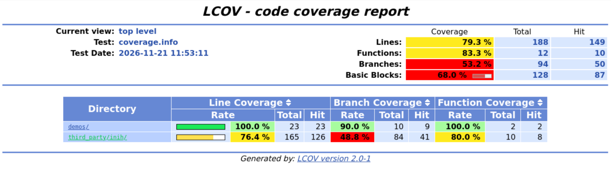

# LCOV Basic Block Coverage

Расширение `genhtml` для анализа покрытия базовых блоков C/C++ программ. Добавляет **Basic Block Coverage** к стандартным метрикам **Lines / Functions / Branches**. Данные собираются из одной инструментированной сборки Clang/LLVM; результаты нескольких запусков объединяются без повторного подсчета блоков.

На страницах исходного кода отображаются метки выполненных и невыполненных BB, сведения о PC и CFG функций. Без аргумента `--bb-report` модифицированный `genhtml` сохраняет стандартный режим.

## Возможности

- Покрытие строк, функций, ветвлений и базовых блоков в одном HTML-отчете
- Расчет доли выполненных блоков по файлам, каталогам и проекту
- Объединение нескольких запусков по идентификатору `(module, pc)`
- Метки BB у исходных строк, фильтр непокрытых блоков и список блоков без DWARF-строки
- CFG функций с входом/выходом, метками возможных переходов, режимами **Simplified** / **Full**
- Проверка совместимости с оригинальным `genhtml` и проверка полного учета PC
- Публикация статических HTML-отчетов без необходимости устанавливать LLVM для их просмотра

## Требования

Проверенная конфигурация: **Debian 13 ARM64**, Clang/LLVM 19, LCOV, Python 3.13+, Perl, Graphviz. Используются C/C++ исходники и исполняемый файл Linux. Поддержка других дистрибутивов и архитектур не проверена в том же объеме.

```bash
sudo apt update
sudo apt install -y build-essential git make curl clang-19 llvm-19 lcov graphviz python3
```

## Быстрый старт: собственный проект

Для небольшого проекта, который можно собрать из набора `.c` / `.cpp` файлов:

```bash
# Из корня репозитория; app.c содержит main()
python3 scripts/coverage_project.py build example --source /path/to/app.c

# Один запуск = один входной сценарий; аргументы передаются программе
python3 scripts/coverage_project.py run example -- input-1
python3 scripts/coverage_project.py run example -- input-2

# Объединение покрытий и генерация трех вариантов HTML
python3 scripts/coverage_project.py report example

xdg-open build/projects/example/html-extended/index.html
```

Если у проекта несколько исходников, добавь `--source` для каждого; заголовочные каталоги задаются через `--include`. Для библиотек с особой системой сборки, зависимостями или генерацией исходников см. [руководство по интеграции](docs/USAGE.md): там описан и ручной способ инструментирования.

**Важное условие:** все тестовые входы должны запускать **один и тот же бинарник**. Повторная сборка меняет карту PC и требует нового набора профилей.

## Воспроизводимые примеры

```bash
make test
bash scripts/check_runtime.sh
bash scripts/demo.sh
```

`demo.sh` загружает фиксированные версии [cJSON v1.7.19](https://github.com/DaveGamble/cJSON) и [inih r62](https://github.com/benhoyt/inih), собирает каждую библиотеку вместе с тестовым драйвером, выполняет 5 и 3 входных сценария и проверяет отчеты.

| Проект | Запуски | Покрытие BB | Совпадение со штатным `genhtml` |
|---|---:|---:|---:|
| cJSON | 5 | 311 / 1324 (23,49%) | 16/16 страниц |
| inih | 3 | 87 / 128 (67,97%) | 16/16 страниц |

Это результаты конкретного запуска на Debian 13/ARM64, а не штатных тестовых наборов upstream-проектов. Они могут отличаться при смене версии Clang/LLVM, LCOV и входных данных. Подробности — в [результатах измерений](docs/RESULTS.md), [сценариях для обеих библиотек](docs/EXAMPLES.md) и [отдельном walkthrough с реальными скриншотами](docs/WALKTHROUGH.md).

Готовые отчеты после выполнения `demo.sh`:

- `build/cjson/html-original/index.html` — системный `genhtml`
- `build/cjson/html-compatible/index.html` — модифицированный `genhtml` без `--bb-report`
- `build/cjson/html-extended/index.html` — четвертая метрика и BB-аннотации
- Аналогичные каталоги `build/inih/html-*`

### Как выглядит расширенный отчет



Снимок из **независимого CLI-запуска `inih-walkthrough`**: 87/128 BB (68,0%). [Пошаговая сборка, запуски, CFG и остальные снимки](docs/WALKTHROUGH.md).

## Публикация HTML

```bash
python3 scripts/publish_reports.py
python3 -m http.server 8000 --directory docs
```

Открой `http://127.0.0.1:8000/`: доступны шесть HTML-отчетов с рабочими внутренними ссылками. `docs/reports/` можно публиковать на GitHub Pages. Подробнее — [docs/PUBLISH.md](docs/PUBLISH.md).

## Документация

- [Использование на собственном C/C++ проекте](docs/USAGE.md)
- [Пример: cJSON и inih, входы и проверка](docs/EXAMPLES.md)
- [Пошаговый CLI-пример inih со скриншотами](docs/WALKTHROUGH.md)
- [Архитектура и технические ограничения](docs/TECHNICAL.md)
- [Навигация по HTML-отчету](docs/TOUR.md)
- [Числовые результаты](docs/RESULTS.md)
- [Скриншоты и рекомендации по их созданию](docs/screenshots/README.md)
- [Публикация HTML и GitHub Pages](docs/PUBLISH.md)

## Ограничения

- Метка рядом со строкой C/C++ — это **место, связанное с PC через DWARF**, а не границы всего базового блока в исходнике
- Если у блока нет надежной строки, он остается в счетчиках и в отдельном списке; ему не присваивается предполагаемая строка
- CFG показывает возможные переходы. Фактическое прохождение ребер не измеряется. Серые узлы означают неподтвержденную привязку к PC
- По умолчанию измеряется факт выполнения блока, а не число его выполнений. Текущий runtime ориентирован на последовательные запуски; `inline-bool-flag` не дает синхронизированного многопоточного подсчета
- `--rc check_data_consistency=0` отключает одну из проверок корректности данных LCOV, необходимых в текущей связке LLVM/LCOV; оригинальный и модифицированный `genhtml` сравниваются с одинаковым параметром

Используемые инструменты: [LLVM SanitizerCoverage](https://clang.llvm.org/docs/SanitizerCoverage.html), [LCOV](https://github.com/linux-test-project/lcov).
