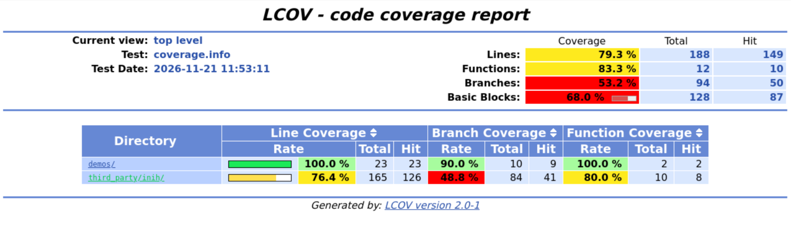
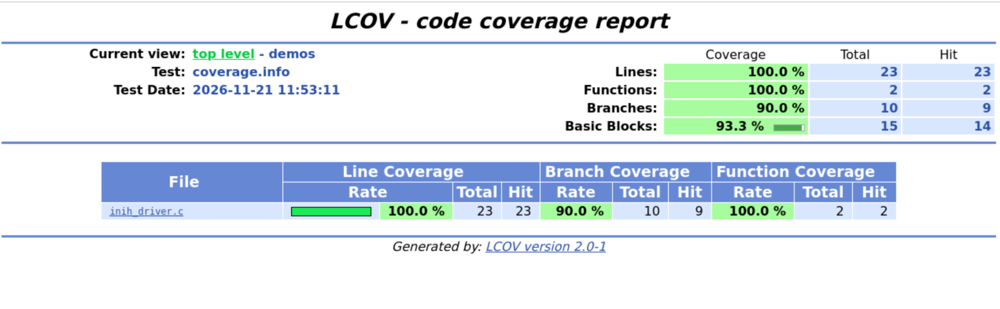
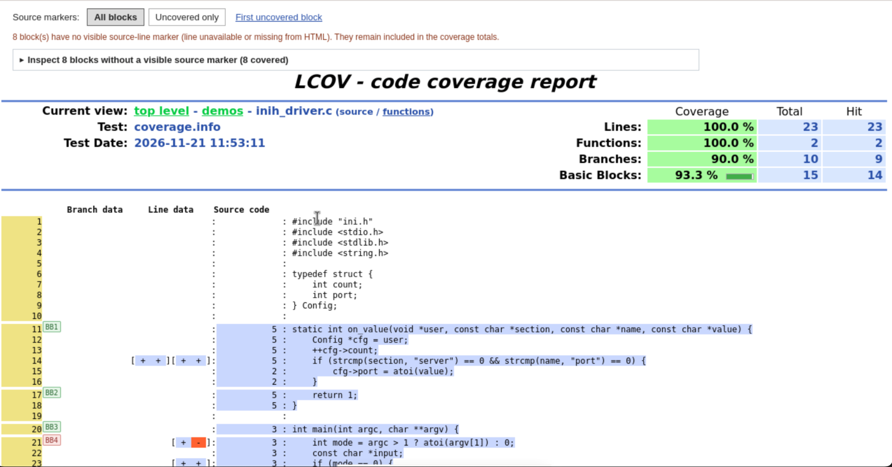
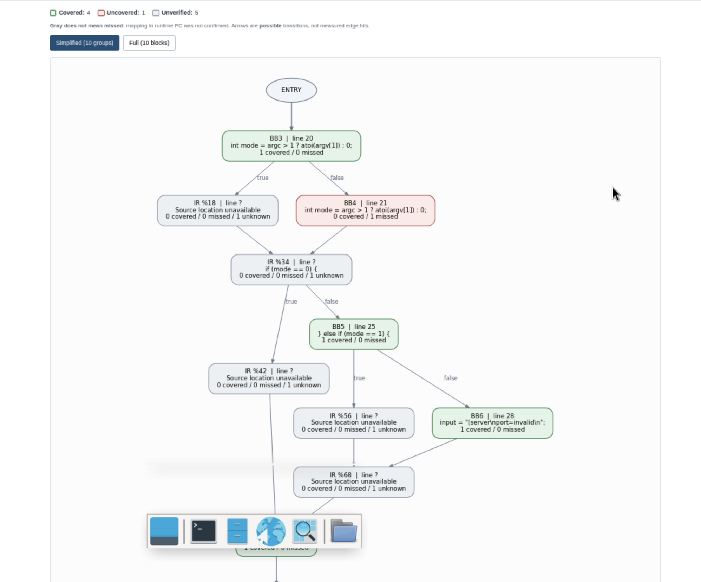
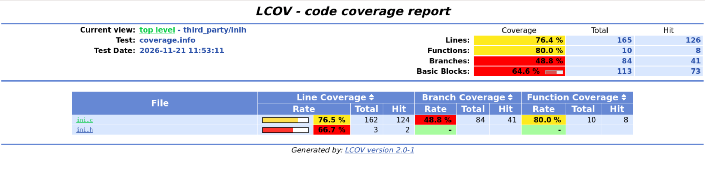

# Пошаговый пример: inih с универсальным CLI

Этот пример показывает применение расширения `genhtml` к стороннему C-проекту **без вызова** встроенного `scripts/demo.sh`. Используется библиотека [inih](https://github.com/benhoyt/inih), тег `r62`, и небольшой драйвер [`demos/inih_driver.c`](../demos/inih_driver.c), реализующий `main()` и три входных сценария.

Проверено на Debian 13 (`aarch64`), Clang/LLVM 19, LCOV 2.0-1. Кадры ниже получены из результата запуска `inih-walkthrough`. Числа относятся к этому набору тестов, а не к полному upstream test suite.

## 1. Получение исходников и сборка

Из корня репозитория расширения:

```bash
mkdir -p third_party
[ -f third_party/inih/ini.c ] || \
  git clone --depth 1 --branch r62 https://github.com/benhoyt/inih.git third_party/inih

python3 scripts/coverage_project.py build inih-walkthrough \
    --source third_party/inih/ini.c \
    --source demos/inih_driver.c \
    --include third_party/inih
```

`build` вызывает `clang-19` для обоих исходников с `-g -O0`, флагами стандартного профилирования и `-fsanitize-coverage=bb,no-prune,inline-bool-flag,pc-table`. Собственный runtime компилируется отдельно, без SanitizerCoverage, и подключается при линковке. Также сохраняется инструментированный LLVM IR для CFG.

## 2. Три независимых запуска

```bash
python3 scripts/coverage_project.py run inih-walkthrough -- 0
python3 scripts/coverage_project.py run inih-walkthrough -- 1
python3 scripts/coverage_project.py run inih-walkthrough -- 2
```

Фактический вывод:

```text
inih: parse=0, entries=2, port=8080
inih: parse=0, entries=2, port=3000
inih: parse=1, entries=1, port=0
```

Все три запуска завершились с кодом 0. Для каждого сохранены стандартный LLVM-профиль (`profiles/*.profraw`) и сведения SanitizerCoverage (`raw/*.jsonl`). Используется **одна и та же сборка** — это необходимо для корректного объединения PC.

## 3. Генерация и проверка отчетов

```bash
python3 scripts/coverage_project.py report inih-walkthrough --strict-mapping
```

На целевой системе получено:

```text
BB coverage: 87/128 (68.0%)
Inputs: 3; unmapped: 0; outside LCOV: 0
Instrumentation OK: 87/128 raw PCs, 87/128 mapped to LCOV; 0 unresolved, 0 outside LCOV
CFG: 12 functions, 51 verified nodes, 77 unverified nodes
Compatibility OK: 16 pages have identical coverage table data
Extended report OK: 2 source file(s), 51 visible BB markers, 87/128 overall
Source-line audit: 51/128 visible source markers; 77 without DWARF line (47 covered); 0 missing from HTML
Report ready: .../build/projects/inih-walkthrough/html-extended/index.html
```

Стандартные значения из того же LCOV-файла:

| Метрика | Покрыто | Всего | Доля |
|---|---:|---:|---:|
| Lines | 149 | 188 | 79,3% |
| Functions | 10 | 12 | 83,3% |
| Branches | 50 | 94 | 53,2% |
| **Basic Blocks** | **87** | **128** | **68,0%** |

Исходный `genhtml` и измененная версия **без** `--bb-report` выдали одинаковые данные покрытия на всех 16 сравниваемых страницах. `--strict-mapping` подтверждает отсутствие PC, несопоставленных с LCOV-файлами; это не означает, что каждому PC известна точная строка исходного кода.

## 4. HTML-отчет и реальные снимки

Открой результат:

```bash
xdg-open build/projects/inih-walkthrough/html-extended/index.html
```

### Сводка проекта



Показывает интеграцию **Basic Blocks** в стандартную сводку LCOV. Процент и счетчики вычисляются по всем 128 инструментированным блокам.

### Покрытие тестового драйвера



Для `demos/inih_driver.c` получено 14/15 BB (93,3%). Это отдельный показатель файла, а не всей библиотеки.

### Исходник и BB-метки



Зеленый BB-маркер означает, что блок выполнялся; красный — что не выполнялся. На скриншоте отдельно показано, что **8 блоков драйвера не имеют видимой привязки к строке**, хотя все восемь покрыты. Они остаются в знаменателе и числителе.

### CFG функции `main`



В показанном графе **10 IR-узлов: 4 покрытых, 1 непокрытый, 5 с неподтвержденной привязкой**. Стрелки подписаны по исходам условий и отражают возможные переходы, а не зарегистрированные прохождения ребер. Серый узел не означает «не выполнен». *На текущем снимке нижняя часть CFG частично закрыта панелью рабочего стола; перед окончательной публикацией лучше заменить его кадром, где виден EXIT.*

### Покрытие библиотеки



Для файлов inih суммарно 73/113 блоков (64,6%). Вместе с драйвером (14/15) это дает **87/128** по проекту. Здесь видно корректное суммирование покрытия на разных уровнях каталога.

## 5. Сравнение с оригинальным `genhtml`

В результате выполнения команды `report` создаются три независимых каталога:

```text
build/projects/inih-walkthrough/html-original/      # системный genhtml
build/projects/inih-walkthrough/html-compatible/    # измененный genhtml без BB
build/projects/inih-walkthrough/html-extended/      # с BB Coverage и CFG
```

Для повторной независимой проверки:

```bash
python3 tools/compare_compat.py \
    build/projects/inih-walkthrough/html-original \
    build/projects/inih-walkthrough/html-compatible
```

Вывод `Compatibility OK` относится к равенству данных покрытия в HTML-таблицах; время генерации и порядок строк не считаются изменением метрик. Измененная `genhtml` по-прежнему поддерживает исходный LCOV-файл и стандартный режим.

## 6. Применение к другому проекту

Замени `ini.c`, `inih_driver.c` и `--include` на свои исходники, сохранив три стадии:

```bash
python3 scripts/coverage_project.py build myapp --source /path/to/myapp.c
python3 scripts/coverage_project.py run myapp -- first-input
python3 scripts/coverage_project.py run myapp -- second-input
python3 scripts/coverage_project.py report myapp
```

Требуется исполняемая программа с `main()`; если анализируется библиотека, понадобится драйвер. Для CMake, дополнительных библиотек, нестандартных инструментов компиляции и ограничений см. [USAGE.md](USAGE.md). Для второго проверенного проекта — [EXAMPLES.md](EXAMPLES.md).
